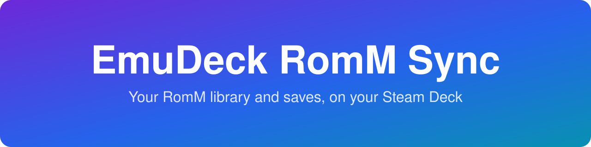

  

# EmuDeck RomM Sync

Browse your [RomM](https://romm.app) library from your Steam Deck, download games straight into
[EmuDeck](https://www.emudeck.com)'s folders, and keep your saves in sync with RomM, all from the
Quick Access Menu, without leaving Gaming Mode.

## What it does

- **Your whole RomM library on the Deck.** Browse by platform or collection, search by title, and
  open a full-screen library with covers.
- **One-press downloads.** Games land in the right EmuDeck folder, extracted or kept zipped as the
  system needs, multi-disc games bundled into a single playlist entry, ready for ES-DE and Steam ROM
  Manager.
- **BIOS files included.** Missing BIOS for a platform download with its first game.
- **Save sync.** Saves from RetroArch, melonDS, mGBA, RMG and DuckStation upload to RomM as you play
  and download on your other devices. Conflicts are never resolved behind your back, and overwritten
  saves are kept as backups.
- **Updates.** When a game's files change on RomM, the plugin offers the update, and your save
  follows the game even when its name changes.
- **Games you already have.** Find my games matches the ROMs already on your Deck against RomM, so
  the plugin can manage them or sync their saves.
- **Safe by design.** The plugin never replaces or deletes a file it didn't download, and never
  deletes a save RomM doesn't hold.

## Requirements

- A Steam Deck (or another SteamOS/Linux handheld) with [Decky Loader](https://decky.xyz).
- [EmuDeck](https://www.emudeck.com), set up with ES-DE.
- A [RomM](https://romm.app) server, version 5.1.0 or newer, reachable from the Deck.

## Install

1. Download `decky-emudeck-romm.zip` from the
   [latest release](https://github.com/chenasraf/decky-emudeck-romm/releases/latest).
2. In Decky's settings, turn on **Developer mode**, then in the **Developer** tab choose **Install
   Plugin from ZIP** and pick the file.
3. Open the Quick Access Menu, choose **EmuDeck RomM Sync** and press **Set up RomM**.

The [getting started guide](docs/getting-started.md) walks through setup and signing in.

## Documentation

- [Getting started](docs/getting-started.md): installing, connecting to RomM, signing in
- [Browsing the library](docs/library.md)
- [Downloading games](docs/downloads.md): where games go, archives, multi-disc games, BIOS, ES-DE
- [Managing games](docs/managing-games.md): deleting, updates, Find my games, games you already had
- [Save sync](docs/save-sync.md): supported emulators, conflicts, slots, backups
- [Settings and plugin data](docs/settings.md)
- [FAQ and troubleshooting](docs/faq.md)

## Contributing

Bug reports and pull requests are welcome. [DEVELOPMENT.md](DEVELOPMENT.md) explains how the plugin
is built and how to run it locally.

## License

[GPL-3.0](LICENSE)
